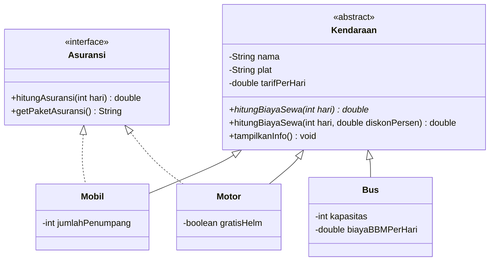

# 🚗 Rental Kendaraan - Praktik Lab Session 3B (PBO)

Program Java berbasis **Object-Oriented Programming (OOP)** yang mensimulasikan sistem rental kendaraan sederhana. Program menghitung biaya sewa untuk tiga jenis kendaraan (mobil, motor, bus), lengkap dengan diskon dan paket asuransi.

Dibuat untuk memenuhi tugas **Praktik Lab Session 3B - Pengembangan Program Berbasis OOP**.

## 📑 Daftar Isi

1. Identitas
2. Deskripsi dan Studi Kasus
3. Ketentuan Tugas dan Pemenuhannya
4. Struktur Project
5. Diagram Class
6. Penjelasan Kode
7. Cara Menjalankan
8. Output dan Penjelasannya
9. Troubleshooting
10. Teknologi

## 👤 Identitas

| | |
|---|---|
| Nama | Fatih Atha Haya |
| NIM | L0325024 |
| Program Studi | S1 Informatika PSDKU Kebumen |
| Universitas | Universitas Sebelas Maret (UNS) |

## 📖 Deskripsi dan Studi Kasus

Studi kasus yang dipilih adalah **rental kendaraan**. Sebuah usaha rental punya beberapa jenis kendaraan, dan tiap jenis punya aturan hitung biaya yang berbeda:

- **Mobil**: biaya sewa = tarif per hari x jumlah hari. Bisa diasuransikan (*Asuransi All Risk*, Rp50.000 per hari).
- **Motor**: biaya sewa = tarif per hari x jumlah hari. Bisa diasuransikan (*Asuransi Dasar*, Rp15.000 per hari).
- **Bus**: biaya sewa = (tarif per hari + biaya BBM per hari) x jumlah hari. Tidak tersedia asuransi.

Hubungan logisnya: semua jenis kendaraan **adalah** `Kendaraan` (pewarisan), sedangkan kemampuan **bisa diasuransikan** adalah kontrak tersendiri (`interface Asuransi`) yang hanya dimiliki sebagian kendaraan. Itu sebabnya asuransi dibuat sebagai interface, bukan dimasukkan ke superclass.

**Fitur program:**
- Menampilkan informasi tiap kendaraan sesuai jenisnya
- Menghitung biaya sewa berdasarkan jumlah hari
- Menghitung biaya sewa dengan diskon (persentase)
- Menghitung biaya asuransi untuk kendaraan yang mendukungnya
- Validasi tarif sewa (tarif harus lebih dari 0)

## ✅ Ketentuan Tugas dan Pemenuhannya

| Ketentuan | Penerapan di program | Lokasi |
|---|---|---|
| **Encapsulation** | Atribut `private`, getter/setter, perubahan data lewat setter dengan validasi | `Kendaraan`, `Mobil`, `Motor`, `Bus` |
| **Inheritance** | 1 superclass dan 3 subclass dengan `extends` dan `super()` | `Kendaraan` -> `Mobil`, `Motor`, `Bus` |
| **Method Overriding** | `@Override` pada `hitungBiayaSewa()` dan `tampilkanInfo()` | Semua subclass |
| **Method Overloading** | `hitungBiayaSewa(int)` dan `hitungBiayaSewa(int, double)` | `Kendaraan` |
| **Runtime Polymorphism** | Objek subclass disimpan di array `Kendaraan[]` | `Main` |
| **Abstract Class** | `Kendaraan` dengan abstract method `hitungBiayaSewa(int)` | `Kendaraan`, diimplementasikan semua subclass |
| **Interface** | `Asuransi` diimplementasikan dengan `implements` | `Mobil`, `Motor` |
| **Minimal 4 class** | 5 class + 1 interface (termasuk `Main`) | Semua file |
| **Minimal 4 objek** | 4 objek: 2 `Mobil`, 1 `Motor`, 1 `Bus` | `Main` |

## 🗂️ Struktur Project

```
src/
└── LabSessionPBO/
    ├── Asuransi.java     # interface
    ├── Kendaraan.java    # abstract class (superclass)
    ├── Mobil.java        # subclass, implements Asuransi
    ├── Motor.java        # subclass, implements Asuransi
    ├── Bus.java          # subclass
    └── Main.java         # program utama
```

## 🧩 Diagram Class



Keterangan: panah segitiga utuh = pewarisan (`extends`), panah segitiga putus-putus = `implements`, tanda `<<abstract>>` dan `<<interface>>` menandai jenis class-nya, dan huruf miring/tanda `*` pada method menandakan abstract method.

## 💻 Penjelasan Kode

Semua file berada di package `LabSessionPBO`. Urutan penjelasan mengikuti urutan dependensi: interface, superclass, subclass, lalu `Main`.

### 1. `Asuransi.java` (interface)

```java
package LabSessionPBO;

// INTERFACE: kontrak yang harus dipenuhi kendaraan yang bisa diasuransikan
public interface Asuransi {
    double hitungAsuransi(int hari);
    String getPaketAsuransi();
}
```

**Penjelasan:**
- `interface` adalah **kontrak**: hanya berisi daftar method yang wajib ada, tanpa isi.
- Method di interface otomatis `public abstract`, jadi tidak perlu ditulis.
- Setiap class yang memakai `implements Asuransi` **wajib** menulis isi dari `hitungAsuransi()` dan `getPaketAsuransi()`. Kalau salah satu terlewat, program tidak bisa di-compile.
- Dipakai interface karena "bisa diasuransikan" bukan sifat semua kendaraan (bus tidak punya). Interface memungkinkan sebagian class saja yang memiliki kemampuan ini.

### 2. `Kendaraan.java` (abstract class / superclass)

```java
package LabSessionPBO;

// ABSTRACT CLASS (superclass) + ENCAPSULATION
public abstract class Kendaraan {
    private String nama;
    private String plat;
    private double tarifPerHari;

    // Constructor
    public Kendaraan(String nama, String plat, double tarifPerHari) {
        this.nama = nama;
        this.plat = plat;
        setTarifPerHari(tarifPerHari); // lewat setter agar divalidasi
    }

    // Getter
    public String getNama() { return nama; }
    public String getPlat() { return plat; }
    public double getTarifPerHari() { return tarifPerHari; }

    // Setter (dengan validasi)
    public void setNama(String nama) { this.nama = nama; }
    public void setTarifPerHari(double tarifPerHari) {
        if (tarifPerHari > 0) {
            this.tarifPerHari = tarifPerHari;
        } else {
            System.out.println("Tarif harus lebih dari 0, perubahan ditolak.");
        }
    }

    // ABSTRACT METHOD: wajib di-implement subclass
    public abstract double hitungBiayaSewa(int hari);

    // OVERLOADING: nama sama, parameter beda
    public double hitungBiayaSewa(int hari, double diskonPersen) {
        double total = hitungBiayaSewa(hari);
        return total - (total * diskonPersen / 100);
    }

    public void tampilkanInfo() {
        System.out.println("Kendaraan : " + nama + " (" + plat + ")");
        System.out.println("Tarif/hari: Rp" + (long) tarifPerHari);
    }
}
```

**Penjelasan:**
- `abstract class` tidak boleh dibuat objeknya langsung (`new Kendaraan(...)` akan error). Fungsinya sebagai cetakan umum untuk semua jenis kendaraan.
- **Encapsulation:** atribut `nama`, `plat`, dan `tarifPerHari` dibuat `private`, jadi tidak bisa diubah langsung dari luar class. Akses hanya lewat getter (`getNama()`, dll.) dan setter (`setNama()`, `setTarifPerHari()`).
- `setTarifPerHari()` punya validasi: tarif yang nol atau negatif ditolak dan data lama tidak berubah.
- Di **constructor**, tarif diisi lewat `setTarifPerHari(tarifPerHari)` dan bukan `this.tarifPerHari = ...`, supaya validasi yang sama ikut berlaku saat objek pertama kali dibuat.
- **Abstract method:** `hitungBiayaSewa(int hari)` hanya dideklarasikan tanpa isi. Tiap subclass wajib mengisinya sesuai aturan hitungnya sendiri.
- **Overloading:** ada dua method bernama `hitungBiayaSewa`, tetapi parameternya beda (`int hari` dan `int hari, double diskonPersen`). Versi kedua memanggil versi pertama lalu mengurangi hasilnya dengan diskon, sehingga subclass tidak perlu menulis ulang logika diskon.
- `tampilkanInfo()` menampilkan data umum (nama, plat, tarif). Method ini akan di-override subclass untuk menambah info khusus.

### 3. `Mobil.java` (subclass, implements Asuransi)

```java
package LabSessionPBO;

// INHERITANCE: Mobil extends Kendaraan, implements Asuransi
public class Mobil extends Kendaraan implements Asuransi {
    private int jumlahPenumpang;

    public Mobil(String nama, String plat, double tarifPerHari, int jumlahPenumpang) {
        super(nama, plat, tarifPerHari);
        this.jumlahPenumpang = jumlahPenumpang;
    }

    public int getJumlahPenumpang() { return jumlahPenumpang; }
    public void setJumlahPenumpang(int jumlahPenumpang) { this.jumlahPenumpang = jumlahPenumpang; }

    @Override
    public double hitungBiayaSewa(int hari) {
        return getTarifPerHari() * hari;
    }

    @Override
    public void tampilkanInfo() {
        super.tampilkanInfo();
        System.out.println("Jenis     : Mobil (" + jumlahPenumpang + " penumpang)");
    }

    @Override
    public double hitungAsuransi(int hari) {
        return 50000 * hari;
    }

    @Override
    public String getPaketAsuransi() {
        return "Asuransi All Risk";
    }
}
```

**Penjelasan:**
- `extends Kendaraan` artinya `Mobil` mewarisi semua atribut dan method `Kendaraan`. `implements Asuransi` artinya `Mobil` juga memenuhi kontrak asuransi.
- Constructor memanggil `super(nama, plat, tarifPerHari)` untuk mengisi atribut milik superclass, lalu mengisi atribut khusus `jumlahPenumpang`. `super()` harus berada di baris pertama constructor.
- `getTarifPerHari()` dipakai karena `tarifPerHari` bersifat `private` di superclass dan tidak bisa diakses langsung.
- `@Override` pada `hitungBiayaSewa()`: mengisi abstract method dari `Kendaraan`. Mobil menghitung tarif x hari.
- `@Override` pada `tampilkanInfo()`: memanggil `super.tampilkanInfo()` dulu (info umum), lalu menambahkan info khusus mobil (jumlah penumpang).
- `hitungAsuransi()` dan `getPaketAsuransi()` adalah isi kontrak dari interface `Asuransi`: Rp50.000 per hari, paket "Asuransi All Risk".

### 4. `Motor.java` (subclass, implements Asuransi)

```java
package LabSessionPBO;

// INHERITANCE: Motor extends Kendaraan, implements Asuransi
public class Motor extends Kendaraan implements Asuransi {
    private boolean gratisHelm;

    public Motor(String nama, String plat, double tarifPerHari, boolean gratisHelm) {
        super(nama, plat, tarifPerHari);
        this.gratisHelm = gratisHelm;
    }

    public boolean isGratisHelm() { return gratisHelm; }
    public void setGratisHelm(boolean gratisHelm) { this.gratisHelm = gratisHelm; }

    @Override
    public double hitungBiayaSewa(int hari) {
        return getTarifPerHari() * hari;
    }

    @Override
    public void tampilkanInfo() {
        super.tampilkanInfo();
        System.out.println("Jenis     : Motor (gratis helm: " + (gratisHelm ? "ya" : "tidak") + ")");
    }

    @Override
    public double hitungAsuransi(int hari) {
        return 15000 * hari;
    }

    @Override
    public String getPaketAsuransi() {
        return "Asuransi Dasar";
    }
}
```

**Penjelasan:**
- Strukturnya sama seperti `Mobil`, tetapi atribut khususnya `gratisHelm` (tipe `boolean`), sehingga getter-nya berawalan `is...` sesuai konvensi Java untuk boolean.
- Perhitungan biaya sewa sama dengan mobil (tarif x hari).
- `tampilkanInfo()` menampilkan "ya" atau "tidak" memakai operator ternary `(gratisHelm ? "ya" : "tidak")`.
- Asuransinya lebih murah (Rp15.000 per hari) dengan paket "Asuransi Dasar". Ini menunjukkan bahwa dua class bisa mengimplementasikan interface yang sama dengan isi berbeda.

### 5. `Bus.java` (subclass tanpa interface)

```java
package LabSessionPBO;

// INHERITANCE: Bus extends Kendaraan (tidak pakai asuransi)
public class Bus extends Kendaraan {
    private int kapasitas;
    private double biayaBBMPerHari;

    public Bus(String nama, String plat, double tarifPerHari, int kapasitas, double biayaBBMPerHari) {
        super(nama, plat, tarifPerHari);
        this.kapasitas = kapasitas;
        this.biayaBBMPerHari = biayaBBMPerHari;
    }

    public int getKapasitas() { return kapasitas; }
    public void setKapasitas(int kapasitas) { this.kapasitas = kapasitas; }

    @Override
    public double hitungBiayaSewa(int hari) {
        // sewa bus sudah termasuk BBM per hari
        return (getTarifPerHari() + biayaBBMPerHari) * hari;
    }

    @Override
    public void tampilkanInfo() {
        super.tampilkanInfo();
        System.out.println("Jenis     : Bus (kapasitas " + kapasitas + " kursi)");
    }
}
```

**Penjelasan:**
- `Bus` hanya `extends Kendaraan` dan **tidak** memakai `implements Asuransi`, sehingga tidak punya method asuransi.
- Atribut khususnya dua: `kapasitas` dan `biayaBBMPerHari`.
- `hitungBiayaSewa()` di-override dengan aturan berbeda: `(tarif + biayaBBMPerHari) x hari`. Ini contoh **polymorphism**: nama method sama, perilaku berbeda tiap class.

### 6. `Main.java` (program utama)

```java
package LabSessionPBO;

public class Main {
    public static void main(String[] args) {
        // RUNTIME POLYMORPHISM: objek subclass disimpan di referensi superclass
        Kendaraan[] daftar = {
            new Mobil("Toyota Avanza", "AD 1234 AB", 350000, 7),
            new Mobil("Honda Brio", "AD 5678 CD", 300000, 5),
            new Motor("Honda Vario", "AD 9012 EF", 80000, true),
            new Bus("Bus Pariwisata", "AD 3456 GH", 1500000, 40, 400000)
        };

        int hari = 3;
        System.out.println("===== RENTAL KENDARAAN - Sewa " + hari + " hari =====\n");

        for (Kendaraan k : daftar) {
            k.tampilkanInfo(); // method overriding -> versi subclass yang jalan
            System.out.println("Biaya sewa: Rp" + (long) k.hitungBiayaSewa(hari));

            // Overloading: versi dengan diskon 10%
            System.out.println("Diskon 10%: Rp" + (long) k.hitungBiayaSewa(hari, 10));

            // Cek kontrak interface
            if (k instanceof Asuransi) {
                Asuransi a = (Asuransi) k;
                System.out.println("Asuransi  : " + a.getPaketAsuransi()
                        + " Rp" + (long) a.hitungAsuransi(hari));
            } else {
                System.out.println("Asuransi  : tidak tersedia");
            }
            System.out.println("------------------------------------");
        }

        // Demo encapsulation: ubah data lewat setter
        System.out.println("\n[Demo Encapsulation]");
        daftar[2].setTarifPerHari(100000);
        System.out.println("Tarif baru " + daftar[2].getNama() + ": Rp" + (long) daftar[2].getTarifPerHari());
        daftar[2].setTarifPerHari(-5000); // ditolak oleh validasi
    }
}
```

**Penjelasan:**
- **Runtime polymorphism:** array bertipe `Kendaraan[]` diisi objek `Mobil`, `Motor`, dan `Bus`. Saat `k.tampilkanInfo()` dipanggil di dalam loop, Java menentukan **saat program berjalan** versi mana yang dijalankan sesuai jenis objek aslinya, bukan tipe variabelnya.
- Di dalam loop `for (Kendaraan k : daftar)`, `k` berganti-ganti menjadi Mobil, Motor, dan Bus. Kode yang dipanggil sama persis, tetapi hasilnya berbeda tiap objek.
- `k.hitungBiayaSewa(hari)` memanggil versi tanpa diskon, sedangkan `k.hitungBiayaSewa(hari, 10)` memanggil versi **overloading** dengan diskon 10%.
- `k instanceof Asuransi` mengecek apakah objek tersebut memenuhi kontrak `Asuransi`. Jika ya, objek di-**cast** ke `Asuransi` agar method asuransinya bisa dipanggil. Bus gagal di pengecekan ini sehingga masuk ke `else`.
- `(long)` dipakai agar angka ditampilkan tanpa desimal (misal `1050000`, bukan `1050000.0`).
- Bagian **Demo Encapsulation**: tarif Honda Vario diubah ke 100000 lewat setter (diterima), lalu dicoba diubah ke -5000 (ditolak oleh validasi sehingga muncul pesan, dan tarif tetap 100000).

## ▶️ Cara Menjalankan

### Lewat NetBeans
1. Buat project Java baru, lalu buat package `LabSessionPBO`.
2. Tambahkan keenam file ke dalam package tersebut.
3. Klik kanan `Main.java`, lalu pilih **Run File** (`Shift + F6`).

### Lewat terminal
Pastikan JDK sudah terpasang, lalu dari folder `src`:

```bash
javac LabSessionPBO/*.java
java LabSessionPBO.Main
```

> Semua file memakai `package LabSessionPBO;` di baris paling atas.

## 🖥️ Output dan Penjelasannya

### Output lengkap

```
===== RENTAL KENDARAAN - Sewa 3 hari =====

Kendaraan : Toyota Avanza (AD 1234 AB)
Tarif/hari: Rp350000
Jenis     : Mobil (7 penumpang)
Biaya sewa: Rp1050000
Diskon 10%: Rp945000
Asuransi  : Asuransi All Risk Rp150000
------------------------------------
Kendaraan : Honda Brio (AD 5678 CD)
Tarif/hari: Rp300000
Jenis     : Mobil (5 penumpang)
Biaya sewa: Rp900000
Diskon 10%: Rp810000
Asuransi  : Asuransi All Risk Rp150000
------------------------------------
Kendaraan : Honda Vario (AD 9012 EF)
Tarif/hari: Rp80000
Jenis     : Motor (gratis helm: ya)
Biaya sewa: Rp240000
Diskon 10%: Rp216000
Asuransi  : Asuransi Dasar Rp45000
------------------------------------
Kendaraan : Bus Pariwisata (AD 3456 GH)
Tarif/hari: Rp1500000
Jenis     : Bus (kapasitas 40 kursi)
Biaya sewa: Rp5700000
Diskon 10%: Rp5130000
Asuransi  : tidak tersedia
------------------------------------

[Demo Encapsulation]
Tarif baru Honda Vario: Rp100000
Tarif harus lebih dari 0, perubahan ditolak.
```

### Penjelasan tiap bagian output

Program memakai `hari = 3`. Berikut asal angka-angkanya:

| Kendaraan | Biaya sewa | Diskon 10% | Asuransi |
|---|---|---|---|
| Toyota Avanza (Mobil) | 350.000 x 3 = **1.050.000** | 1.050.000 - 105.000 = **945.000** | 50.000 x 3 = **150.000** (All Risk) |
| Honda Brio (Mobil) | 300.000 x 3 = **900.000** | 900.000 - 90.000 = **810.000** | 50.000 x 3 = **150.000** (All Risk) |
| Honda Vario (Motor) | 80.000 x 3 = **240.000** | 240.000 - 24.000 = **216.000** | 15.000 x 3 = **45.000** (Dasar) |
| Bus Pariwisata (Bus) | (1.500.000 + 400.000) x 3 = **5.700.000** | 5.700.000 - 570.000 = **5.130.000** | tidak tersedia |

Penjelasan baris per baris:

- **`Kendaraan : ... / Tarif/hari: ...`** dicetak oleh `tampilkanInfo()` milik `Kendaraan`, yang dipanggil lewat `super.tampilkanInfo()` oleh tiap subclass.
- **`Jenis : ...`** dicetak oleh `tampilkanInfo()` milik subclass masing-masing, sehingga isinya berbeda (penumpang untuk mobil, helm untuk motor, kapasitas untuk bus). Ini bukti **method overriding** dan **runtime polymorphism**.
- **`Biaya sewa`** berasal dari `hitungBiayaSewa(hari)`. Rumus bus berbeda karena ada tambahan biaya BBM.
- **`Diskon 10%`** berasal dari versi **overloading** `hitungBiayaSewa(hari, 10)`.
- **`Asuransi`** hanya tampil untuk Mobil dan Motor karena keduanya `implements Asuransi`. Bus mencetak "tidak tersedia".
- **`[Demo Encapsulation]`**: tarif Honda Vario berhasil berubah menjadi Rp100000 lewat setter. Percobaan mengubah ke -5000 ditolak dan muncul pesan `Tarif harus lebih dari 0, perubahan ditolak.`

## 🔧 Troubleshooting

**Banyak tanda error merah di NetBeans padahal kode sudah ditempel.**
Biasanya karena class tertulis dobel. Saat membuat file baru, NetBeans otomatis menulis kerangka `public class NamaClass { }`. Kalau kode lengkap ditempel di dalamnya, deklarasi class jadi dua. Solusinya: hapus kerangka bawaan NetBeans (baris `public class ... {` dan satu `}` penutup yang berlebih), sisakan deklarasi dari kode yang ditempel. Pastikan baris `package LabSessionPBO;` tetap ada di paling atas.

**`error: class X is public, should be declared in a file named X.java`.**
Nama file harus sama persis dengan nama class publiknya (huruf besar/kecil juga).

**`package LabSessionPBO does not exist` saat compile lewat terminal.**
Jalankan perintah dari folder `src` (satu level di atas folder `LabSessionPBO`), bukan dari dalam foldernya.

## 🛠️ Teknologi

- Java (JDK 8 atau lebih baru)
- Apache NetBeans IDE
