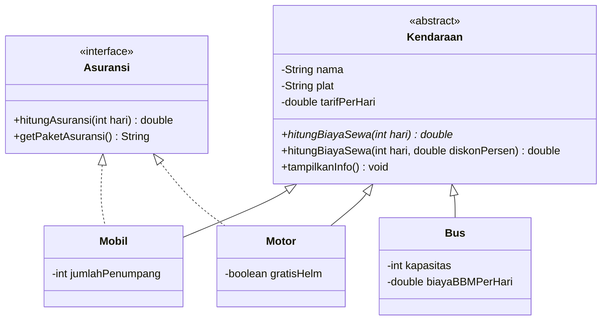

# 🚗 Rental Kendaraan - Praktik Lab Session 3B (PBO)

Program Java berbasis **Object-Oriented Programming (OOP)** yang mensimulasikan sistem rental kendaraan sederhana. Program menghitung biaya sewa untuk berbagai jenis kendaraan (mobil, motor, bus), lengkap dengan diskon dan paket asuransi.

Dibuat untuk memenuhi tugas **Praktik Lab Session 3B - Pengembangan Program Berbasis OOP**.

## 👤 Identitas

| | |
|---|---|
| Nama | Fatih Atha Haya |
| NIM | L0325024 |
| Program Studi | S1 Informatika PSDKU Kebumen |
| Universitas | Universitas Sebelas Maret (UNS) |

## ✨ Fitur

- Menampilkan informasi tiap kendaraan sesuai jenisnya
- Menghitung biaya sewa berdasarkan jumlah hari
- Menghitung biaya sewa dengan diskon (persentase)
- Menghitung biaya asuransi untuk kendaraan yang mendukungnya
- Validasi tarif sewa (tarif harus lebih dari 0)

## 🗂️ Struktur Project

```
src/
└── LabSessionPBO/
    ├── Asuransi.java     # interface
    ├── Kendaraan.java    # abstract class (superclass)
    ├── Mobil.java        # subclass, implements Asuransi
    ├── Motor.java        # subclass, implements Asuransi
    ├── Bus.java          # subclass
    └── Main.java         # program utama
```

## 🧩 Diagram Class



## 📚 Penerapan Konsep OOP

| Konsep | Penerapan |
|---|---|
| **Encapsulation** | Atribut `private` di `Kendaraan` dan subclass, diakses lewat getter/setter. `setTarifPerHari()` memvalidasi input. |
| **Inheritance** | `Mobil`, `Motor`, dan `Bus` memakai `extends Kendaraan` dan memanggil `super()` di constructor. |
| **Method Overriding** | `hitungBiayaSewa()` dan `tampilkanInfo()` di-override dengan `@Override` pada tiap subclass. |
| **Method Overloading** | `hitungBiayaSewa(int hari)` dan `hitungBiayaSewa(int hari, double diskonPersen)`. |
| **Runtime Polymorphism** | Array `Kendaraan[]` berisi objek `Mobil`, `Motor`, dan `Bus`, lalu dipanggil dalam satu loop. |
| **Abstract Class** | `Kendaraan` memiliki abstract method `hitungBiayaSewa(int hari)` yang diimplementasikan semua subclass. |
| **Interface** | `Asuransi` diimplementasikan `Mobil` dan `Motor` dengan keyword `implements`. |

## ▶️ Cara Menjalankan

### Lewat NetBeans
1. Buka project di NetBeans.
2. Klik kanan `Main.java`, lalu pilih **Run File** (`Shift + F6`).

### Lewat terminal
Pastikan JDK sudah terpasang, lalu dari folder `src`:

```bash
javac LabSessionPBO/*.java
java LabSessionPBO.Main
```

> File `.java` memakai `package LabSessionPBO;` di baris paling atas.

## 🖥️ Contoh Output

```
===== RENTAL KENDARAAN - Sewa 3 hari =====

Kendaraan : Toyota Avanza (AD 1234 AB)
Tarif/hari: Rp350000
Jenis     : Mobil (7 penumpang)
Biaya sewa: Rp1050000
Diskon 10%: Rp945000
Asuransi  : Asuransi All Risk Rp150000
------------------------------------
Kendaraan : Honda Brio (AD 5678 CD)
Tarif/hari: Rp300000
Jenis     : Mobil (5 penumpang)
Biaya sewa: Rp900000
Diskon 10%: Rp810000
Asuransi  : Asuransi All Risk Rp150000
------------------------------------
Kendaraan : Honda Vario (AD 9012 EF)
Tarif/hari: Rp80000
Jenis     : Motor (gratis helm: ya)
Biaya sewa: Rp240000
Diskon 10%: Rp216000
Asuransi  : Asuransi Dasar Rp45000
------------------------------------
Kendaraan : Bus Pariwisata (AD 3456 GH)
Tarif/hari: Rp1500000
Jenis     : Bus (kapasitas 40 kursi)
Biaya sewa: Rp5700000
Diskon 10%: Rp5130000
Asuransi  : tidak tersedia
------------------------------------

[Demo Encapsulation]
Tarif baru Honda Vario: Rp100000
Tarif harus lebih dari 0, perubahan ditolak.
```

## 🛠️ Teknologi

- Java (JDK 8 atau lebih baru)
- Apache NetBeans IDE
